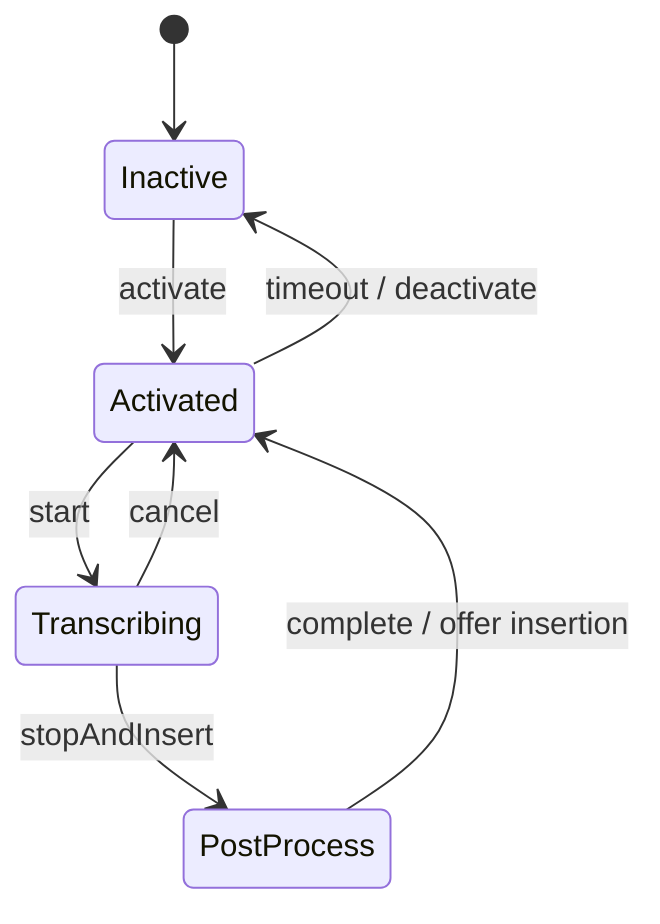

# Keyboard readiness

Saywick uses Parakeet for every new dictation and imported recording. Initial
microphone activation occurs in the app process. Recording shortcuts use AudioRecordingIntent plus
LiveActivityIntent. Cold activation opens Saywick with dynamic foreground
continuation because direct background activation failed on the test iPhone.
Dictation restarts while the microphone is ready stay in the background.

With Keep keyboard ready enabled, completing a dictation starts a 120-second idle
deadline. Beginning another dictation clears it; that recording can run longer than
two minutes. Completing it creates a new deadline. Clear, insertion, and ordinary
typing do not extend readiness. End, expiry, interruption, or failure releases the
microphone. Expiry preserves finished text for insertion. Idle audio is discarded.

The shared snapshot distinguishes microphone ownership from the optional idle
deadline. A recording has an active session with no deadline; an idle ready session
has both. A heartbeat older than five seconds makes the session unavailable to the
keyboard, even if its deadline has not passed. Old snapshot and History formats
remain decodable. Clearing an inactive shared snapshot clears both session fields.

The resting keyboard opens with QWERTY and a toolbar for More, Undo insertion,
Polish, and the microphone. Each appearance resets the symbol page to letters.
Active dictation, processing, and unconsumed results show the transcript instead.
Insertion returns to typing and exposes Fix a word. QWERTY, single-use
Shift, numbers, punctuation, space, Return, held delete, and cursor dragging operate
without Full Access. Full Access is needed only for local dictation communication.
When inactive, the mic uses a user-tapped SwiftUI URL action to request
`saywick://start?source=keyboard`. Rejection displays
inline fallback instructions. No refresh or timer opens the app.
A single primary action reflects access, freshness, preparation, recording, finalization,
and idle readiness. More expands auxiliary actions inline; keyboard controls never present modal alerts.

Physical-device release checks: complete a dictation and wait two minutes, confirm
orange microphone indicator disappears and text remains insertable; restart before
expiry and dictate beyond the old deadline; confirm Clear/typing does not extend
the idle deadline; verify interruption, locked phone, and End behavior. Also test
letters, Shift, symbols, delete, globe, and Return with Full Access disabled in Notes.

## Meeting sessions

Build 1.0 (5) removed dedicated meeting recording. History still reads earlier recordings. The September 7 verification below describes an earlier build. [Release record](app-store-release.md)

A single AppModel.shared is used by both the SwiftUI scene and recording intents.
It owns long-lived command/interruption tasks. The startup task removes orphaned
Live Activities before new recording requests; repeated calls cannot start duplicate
observers or clean up an activity just created by a concurrent intent.

Background starts never request first-time microphone permission or download model
weights. They fail with setup guidance when prerequisites are missing. The recorder
requests its Live Activity before microphone activation and retains it until audio
capture has stopped. Both lock-screen and expanded Dynamic Island views offer a
Stop AudioRecordingIntent routed to the containing app.

## Device verification (2026-09-07)

On the connected iPhone, direct cold background activation returned “Session
activation failed,” including after a fresh install. Start shortcuts therefore use
system foreground continuation when activating an inactive microphone; meeting
starts use foreground continuation as well. This is not parity with Spokenly's
advertised no-switch activation.

The final signed build passed two physical-device smoke tests: meeting capture
started in the app, and a meeting started through the native Shortcuts Saywick
page from a terminated process. Both continued after pressing Home for five
seconds and saved successfully after returning and stopping. The 52 core tests,
three meeting app tests (including a 30-minute import fixture), and meeting UI
regression passed. Four-hour endurance, locked-screen capture, and the Live Activity
Stop button still need hands-on verification; the short background tests do not
establish those results.

## One-button flow and insertion acknowledgment

`DictationSession` is the authoritative state. `DictationController` owns its
transitions and microphone lifetime. A single pending operation describes
activation, start, cancellation, or release; controls do not claim readiness while
those operations are settling. Fatal errors and interruptions preserve recovery
work, cancel insertion, release capture, and attempt one descending error cue.
They return to Inactive with a persistent reason, without automatically restarting.
Disabling Keep keyboard ready returns completed/cancelled dictations to Inactive.

Cancel does not finalize recognition or post-process text. It preserves existing
recovery audio/history with a Cancelled status. Restart composes Cancel and Start.

Results are independent of microphone readiness. Stop & Insert offers a completed
result; insertion occurs only when the keyboard is available. The keyboard writes
receipts after insertion or dismissal and never rewrites the app's session snapshot.
Receipts survive keyboard recreation. Host insertion and receipt persistence cannot
be atomic across processes, so crash-proof exactly-once insertion is not promised.
Old snapshots remain readable. New commands are acknowledged by ID, including
rejections; a timeout offers retry with the same ID rather than inventing a state.

The app observes audio interruptions, route changes, engine configuration changes,
and media-services reset. Invalid/stopped capture ends the session. Audio archive
writes and conversion run on an audio worker; recording History writes run on a
separate serial worker. Active archives use complete-unless-open protection; shared
metadata uses protection until first unlock so it can be reopened while locked.

Error sound playback uses the current output and media volume; a car route, zero
volume, or system interruption can make it inaudible. The error message remains
available. Playback is cancelled before starting capture or History playback.
Physical car and call interruption behavior requires device verification; a
simulated notification does not establish that a particular car route is audible.

## One-dictation templates

During an active OpenAI recording with saved templates, tapping the cleanup control opens a scrollable list inside the keyboard. Apple models show the ordinary Polish toggle. The keyboard receives names and IDs only. The app validates the recording ID, resolves the prompt, and acknowledges the choice before the keyboard shows it as selected. Stop captures that choice for this recording. The usual Polish or Off preference survives completion, cancellation and failure. A failed template leaves a notice visible after insertion.

## Dictionary

Users add correctly spelled words or phrases, one per line or through Add. Standalone
terms get conservative local spelling/sound matching before punctuation cleanup.
Exact `heard = preferred` aliases remain available. Corrections use no remote model;
this is a heuristic, not contextual ASR biasing. Close competing candidates remain
unchanged, and a small set of common name/word collisions is protected. Unusual
pronunciations and unlisted homonyms may still need explicit rules. Original History
transcripts remain available.

Add names from Contacts uses the system multi-selection picker, followed by a
review before adding. Only selected given/family/full names enter the dictionary;
no address-book enumeration, phone numbers, or emails are stored. Duplicates are
removed case-insensitively. Imported names can be edited/deleted in the word list.

The keyboard uses a light gray or dark background with rounded keys. The transcript
layout requests 250 points and typing 274, with extra height for visible status,
correction, or inline menu rows.
The bottom row is pinned six points from the extension edge; iOS owns the separate
globe/microphone area below the extension.
