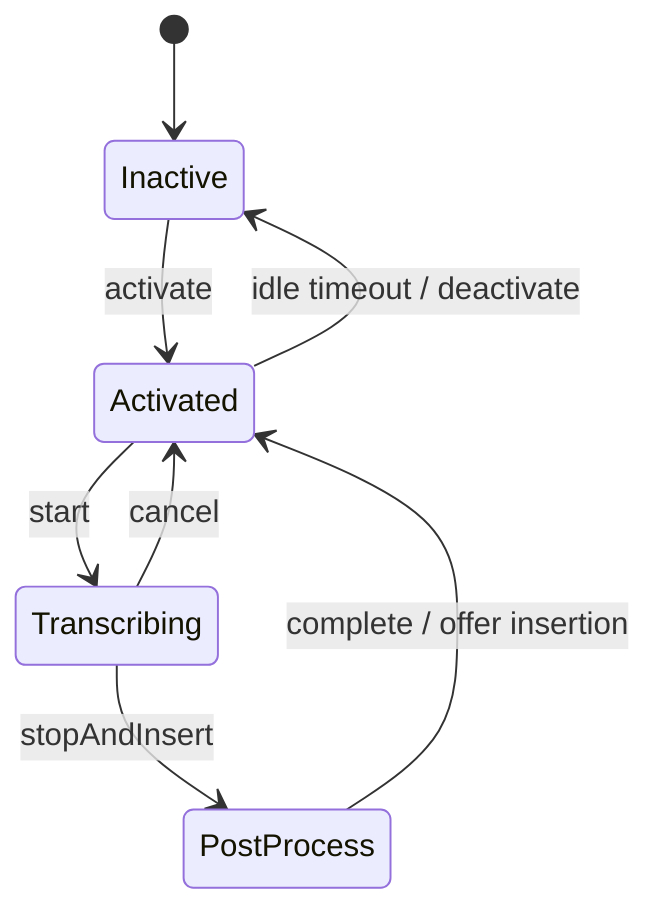

# Keyboard state refactoring plan

Status: implemented, automated gates passed, and Release installed on the iPhone. See `keyboard-session.md` for the resulting contract and `refactor-verification.md` for measured results and remaining hands-on checks.

## Intended behavior

Use the user's three-state dictation loop, with `Inactive` for activation, expiry,
and loss of microphone access. `Activated` means the microphone session is usable,
not that the containing app is in the foreground.

Exceptional rule: a fatal recording error or interruption ends microphone
ownership, preserves recoverable work, cancels automatic insertion, and attempts
one error sound. The state becomes `Inactive` with a reason. This rule applies
across the active flow; it does not need a permanent `Failed` state or a web of
arrows in the main diagram. A cleanup-model failure that successfully falls back
to basic cleanup remains a successful completion with a warning.

The diagram describes completed transitions. Activation, starting capture, and
cancellation still take time. Show pending progress and disable conflicting
commands until their effects complete; never advertise readiness before hardware
and cleanup are ready. Represent the one pending operation explicitly, not with
separate `starting`, `ending`, `resetting`, and `failureCleanup` booleans.

## Why the current implementation is difficult to reason about

- `AppModel` combines six phases with microphone ownership, optional expiry,
  operation identity, and multiple busy flags. Readiness is reconstructed elsewhere.
- `KeyboardRecordingState.resolve` derives seven display states, then the keyboard
  overrides them again with its own pending-action state.
- App `ready` means a completed result, which can exist with the microphone off.
  Completed text and microphone readiness are separate facts but share a phase.
- `MicrophoneCapture.keepsSessionAlive` and `AppModel.isKeyboardSessionActive`
  both influence resource ownership. Engines also stop/deactivate the shared session.
- Keyboard `clearSnapshot` performs a read/modify/write of recorder state. Atomic
  writes do not make that whole transaction safe against a concurrent app write.
- Commands occupy one file; newer writes can replace commands not yet consumed.
  Pending-action acknowledgment guesses from phase and timestamps. Snapshot dates
  use ISO-8601 encoding without an explicit fractional-seconds strategy, while the
  keyboard compares them against full-precision local dates.
- `stop()` finalizes recognition; no engine-level cancel operation exists.
  Clear/Restart resets and resumes recording, rather than implementing Cancel.
- Dictation and meetings share orchestration even though meetings save audio and
  intentionally skip recognition and post-processing.

## Proposed ownership

1. Add a small dictation state/event model in `VoiceKeyboardCore`. A concrete
   transition function accepts an event and produces the next state and required
   effects. Keep it domain-specific; no state-machine framework or generic bus.
2. Add one `@MainActor` dictation controller in the app to execute those effects.
   It owns the current run, one pending operation, and a generation token. Engine
   and processing completions carry that token; stale completions have no effect.
   Events remain processable while an async effect runs, so an interruption can
   invalidate ongoing activation or processing immediately.
3. Make `AppModel` a UI/settings facade. App buttons, keyboard commands, spoken
   commands, and Shortcuts send events to the same controller. They do not mutate
   session state directly. Derive busy/canStart/canCancel from controller state.
4. Give the controller sole authority over microphone retention and release.
   `MicrophoneCapture` performs hardware operations; engines consume audio and
   manage recognition/archive work. Engines cannot independently deactivate the
   shared audio session. Error playback belongs to the same resource sequence.
5. Publish controller state for the keyboard and Live Activity. Full Access and
   connection freshness remain UI availability checks, not dictation states.
   A stale snapshot means recorder unavailable; it is not proof the mic stopped.

Keep completed results outside the session enum: result ID, text, disposition
(save only or offer insertion), and insertion receipt. Returning to `Activated`
must not depend on a keyboard being visible or successfully inserting text.

## Command semantics

| Event | Proposed behavior |
| --- | --- |
| Activate | Establish readiness; cold Start can compose Activate then Start. |
| Start | Begin a new run, clear idle expiry, enter Transcribing after capture starts. |
| Stop and Insert | Stop capture delivery, finish recognition, process text, persist result, offer insertion, return to Activated. |
| Stop | Same completion pipeline with save-only disposition. |
| Cancel | Stop current run without recognition finalization, post-processing, or insertion; return to Activated after cleanup. |
| Restart | Compose Cancel then Start; no separate reset lifecycle. |
| Clear completed text | Dismiss a result; does not alter microphone state or readiness deadline. |
| Deactivate while recording | Preserve existing explicit-End behavior: finish/save without insertion, then release microphone. |
| Timeout | Release microphone only from idle Activated, never during recording or processing. |

Proposed Cancel retention policy: preserve already-retained recovery audio/history,
mark it Cancelled, and discard the live draft from the keyboard. Do not silently
delete recovery files as part of a structural refactor. Returning to Activated
after Cancel starts a new idle deadline, just as completion does.

Keep “Keep keyboard ready” as a completion policy: when disabled, successful
completion/cancellation returns to Inactive. Keep existing keyboard-dismissal
behavior under that policy. This is an explicit exception to the default diagram,
not a reason to maintain independent phase and ownership flags.

## Implementation sequence

### 1. Establish the contract with focused tests

Introduce the state/event model and deterministic tests with an injected clock.
Specify legal commands, pending operations, idle expiry, error handling, and
completion dispositions. Keep existing runtime behavior until the controller is
wired in. A transition table is the source for tests and the short Mermaid diagram.

### 2. Implement real cancellation and explicit resource ownership

Split the engine's finish and cancel operations. Cancel stops delivery, settles
in-flight buffer/archive work, and releases recognition resources without emitting
a final transcript. `ParakeetWorker.cancel()` exists, but cannot preempt native
work already executing on its actor: remain pending until resources settle.
Remove silent no-op reset defaults from the engine interface. Centralize ordering
of capture shutdown, archive close, error cue, and session deactivation. Ordinary
Stop/Cancel/expiry stays silent; unexpected termination emits one cue attempt.

### 3. Move dictation orchestration out of AppModel

Route start, stop, cancel, restart, interruption, and expiry through the controller.
Replace phase/ownership/busy mutations with its state and pending operation.
Retain the generation guard for asynchronous results. Keep compatibility snapshot
encoding temporarily so this step does not also rewrite the keyboard protocol.
Remove old paths as their replacements land; do not leave two active controllers.

### 4. Make the keyboard a client of that state

Publish canonical state plus explicit command acknowledgment by command ID,
including rejection reasons. Allow only one outstanding keyboard command; timeout
shows unavailable/retry guidance without guessing acknowledgment from timestamps
or assuming a stop succeeded. Retry the same ID and deduplicate it in the app.
Keep the existing file transport initially; do not introduce a networking layer.

The app becomes the sole writer of session snapshots. The keyboard writes commands
and separate result receipts. Persist receipts so reopening the extension does not
normally reinsert consumed text. Acknowledge only after calling insertText; do not
claim crash-proof exactly-once insertion, since host-app insertion and receipt
persistence cannot be one atomic transaction. Dismiss/consume can remain local
while the app is suspended, without clearing recorder state.

Preserve decoding of existing snapshots via an adapter; publish the new optional
state/ack fields during migration. Eventually remove old inference and the
keyboard's speculative Starting/Finishing state overrides.

### 5. Keep meeting behavior separate, then remove obsolete code

Meetings retain their existing save-only workflow and four-hour limit. Give them
a small dedicated orchestration path sharing the microphone service, with mutual
exclusion at the app entry point. Do not force meetings through PostProcess or
change their retention behavior. Migrate their resource calls before deleting the
old shared microphone ownership paths. Remove dead phase/flag/reset code and
replace the long keyboard diagram with the agreed contract and exception rules.

## iOS practices required during this refactor

Reviewed against Apple documentation on 2026-09-09. These are concrete additions
to the implementation steps above. The four-state design and ownership boundaries
are our engineering choices; Apple does not prescribe this particular architecture.
Keep the implementation small and use the existing frameworks and test suites.

### Audio lifecycle and the car-connection failure (steps 2–3)

Observe interruption begin/end, route changes, engine configuration changes, and
media-services lost/reset. Convert notifications into controller events; do not
tear down an engine synchronously on its notification callback queue. Distinguish
a harmless output change from invalid input or a stopped graph. Hardware channel
count/sample-rate changes can stop the engine while leaving its nodes attached
with old formats. On the next explicit activation, rebuild taps/connections and
converters using the actual hardware format. After a media-services reset,
recreate affected audio objects and restore session configuration.

For this refactor, interrupted/invalid capture goes to Inactive with recovery
guidance; no silent automatic recording restart. Interruption-ended is not a Start
command. Do not label a recording continuous when samples were lost. Record the
event type, route port type, format, and state transition to diagnose the car case.
The current code watches interruption begin and polls engine running state; it
does not explicitly handle configuration changes or media-services resets.

Sources: [interruptions](https://developer.apple.com/documentation/avfaudio/handling-audio-interruptions),
[route changes](https://developer.apple.com/documentation/avfaudio/responding-to-audio-route-changes),
[engine configuration changes](https://developer.apple.com/documentation/foundation/nsnotification/name-swift.struct/avaudioengineconfigurationchange),
[media-services reset](https://developer.apple.com/library/archive/qa/qa1749/_index.html).

### Concurrency and responsiveness (steps 1–3)

Keep observable state/UI mutation on MainActor. Perform model loading, inference,
audio conversion, archive writes, and substantial persistence work off that actor
through explicitly owned workers. An `async` function or `Task {}` alone does not
establish that boundary: current capture consumers inherit their engine's
MainActor isolation. Keep audio callbacks bounded and free of inference, file I/O,
or waits on UI work; retain overflow detection and measure buffer/lock overhead.

Inject only dependencies needed for deterministic tests: engine/audio access,
processor, persistence, clock, and feedback. Prefer structured child tasks; explicitly
own, cancel, and finish long-lived observer/stream tasks. Check cancellation and
run identity after suspension before committing results. Preserve Swift 6 strict
concurrency checking; do not add unchecked Sendable conformance to silence errors.
Existing callback wrappers need documented synchronization guarantees.

Source: [Embracing Swift concurrency](https://developer.apple.com/videos/play/wwdc2025/268/).

### App/extension lifetime and energy (steps 3–4)

Keep audio and models in the containing app, with a lightweight keyboard extension.
Keep normal typing, globe switching, and usable Full Access guidance available
without dictation access. Recheck availability when the extension appears; neither
an app-group file nor a Live Activity proves the recorder process is alive.
Observers and recording work belong to the app service, not a transient view task.
Never rely on receiving a termination callback to save recoverable work.

Reduce the unconditional 200 ms polling loop where notifications can supply the
event, and use one cancellable idle deadline. Retain a bounded heartbeat/command
fallback while the file transport needs it. Stop unnecessary polling when inactive
or the keyboard is hidden. Any file watcher must tolerate atomic file replacement;
it cannot wake a suspended app by itself. Preserve the tested explicit activation
flow, and do not introduce silent-audio keepalive or assume timers grant background
execution. Measure wakeups and command latency before changing poll intervals.

Sources: [custom keyboard lifecycle and limits](https://developer.apple.com/library/archive/documentation/General/Conceptual/ExtensibilityPG/CustomKeyboard.html),
[App Groups](https://developer.apple.com/documentation/xcode/configuring-app-groups),
[timer efficiency](https://developer.apple.com/library/archive/documentation/Performance/Conceptual/EnergyGuide-iOS/MinimizeTimerUse.html).

### Accessible, actionable feedback (steps 3–4)

Pair the error cue with a persistent, specific message and a recovery action in the
app/keyboard. Announce important changes to VoiceOver once; do not announce every
heartbeat or transcript partial. Verify labels, enabled state, focus order, touch
targets, and Dynamic Type layouts for recording controls and error messages. Sound
is supplementary: media volume, car routing, or a system interruption may make it
inaudible. Keep the error available after the cue and when the keyboard reopens.

Route cue playback through the controller's resource lifecycle. A stale cue
completion must not deactivate a newly started recording or History playback.
Test interruption during the cue and failure to activate its playback session.

Sources: [accessibility design](https://developer.apple.com/design/human-interface-guidelines/accessibility),
[accessibility testing](https://developer.apple.com/documentation/accessibility/performing-accessibility-testing-for-your-app).

### Recovery, privacy, and diagnostics (steps 2–5)

Preserve local processing, retention preferences, and recovery checkpoints. Make
file protection explicit for audio archives and shared metadata, and verify both
writing and reopening while locked. `completeUnlessOpen` permits continued access
to a file opened while unlocked, but is unsuitable for metadata that must be
repeatedly reopened while locked. Choose protection per file role; document the
tradeoff and test first unlock after reboot. Handle inaccessible files as an
availability condition rather than overwriting them with empty state.

Audit first-party targets for required-reason API usage and add accurate privacy
manifests where required; no first-party `.xcprivacy` file was found in this review.
Use only declarations matching actual usage, including UserDefaults/App Groups;
check generated archive contents rather than assuming a dependency covers the app.
Keep permission prompts in a user-initiated foreground setup flow.

Diagnostics must use typed event labels and error domain/code, excluding transcript
text, user paths, and route device names. The current logger marks all supplied
strings public; the new sound catch passes `localizedDescription`, which should be
replaced with structured safe fields. Keep diagnostics bounded and add timing
measurements for start, cancellation, processing, and audio gaps.

Sources: [file protection](https://developer.apple.com/documentation/foundation/urlfileprotection/completeunlessopen),
[privacy manifests](https://developer.apple.com/documentation/bundleresources/adding-a-privacy-manifest-to-your-app-or-third-party-sdk),
[required-reason APIs](https://developer.apple.com/documentation/bundleresources/describing-use-of-required-reason-api).

### Testing and completion evidence (all steps)

Keep existing XCTest suites; a wholesale test-framework migration is unnecessary.
Use deterministic unit tests for transitions, integration tests for effects and
persistence, and UI tests for actual user actions. Inject isolated temporary
storage and defaults so tests cannot modify personal History or app settings.
Use controllable completions instead of sleeps for race tests. Keep physical-device
tests distinct from simulator tests and report skips honestly.

In addition to the 70% coverage gate below, run accessibility checks and collect
performance baselines for start/stop latency, memory during longer recording, and
main-thread responsiveness. Exercise route-format changes, media-services reset,
denied microphone permission, Full Access off, protected-data unavailability, and
disk-write failure. Include cue/recording/History-playback contention. Store the
test results and device verification notes with the refactor's final report.

Sources: [Xcode testing](https://developer.apple.com/documentation/xcode/adding-tests-to-your-xcode-project),
[coverage measurement](https://developer.apple.com/documentation/xcode/determining-how-much-code-your-tests-cover).

## Acceptance checks

### Required coverage gate

The project already has core unit tests, app tests, and UI/device tests. The last
verified core run passed 58 tests; the targeted microphone run passed two tests
and skipped its physical-device test. These counts do not establish coverage.
Neither the current Makefile test command nor the checked-in Xcode scheme enables
coverage collection or enforces a percentage threshold.

At completion of this refactor, require **at least 70% executable-line coverage
across first-party production Swift code under `Sources/`**. Also require at least
70% for the refactored dictation controller/state/keyboard command handling as a
group, so unrelated well-covered utilities cannot hide gaps in this work.

- Before changing runtime behavior, collect and save a baseline with SwiftPM
  coverage enabled and Xcode coverage enabled for app/extension tests.
- Add a reproducible coverage command and a failing threshold check to the build
  workflow. Run it as a required final refactoring check; connect it to CI if CI
  is introduced. Save the report with tested revision, commands, and skipped tests.
- Combine coverage by canonical source path and executable line, unioning hits
  from multiple test runs/targets. Do not average target percentages or count
  shared files twice. Missing production files are coverage gaps, not implicit
  exclusions; instrument all production targets to establish their denominator.
- Exclude tests, benchmark tools, generated code, and third-party dependencies.
  Do not exclude first-party UI or hardware code simply to reach the threshold.
  Where device execution is needed, collect it explicitly; skipped tests contribute
  no execution evidence.
- Add meaningful tests for uncovered behavior, prioritizing the transitions and
  races below. A percentage does not replace the behavioral acceptance checks.

The refactor must not be reported complete until the measured gate passes. Current
coverage is unknown; do not infer it from passing test counts.

### Behavioral checks

- Start → Stop and Insert produces one result; repeated Stop is harmless.
- Cancel never calls recognition finish or text processing and never inserts;
  Cancel → Start ignores all callbacks from the cancelled run.
- Interruption during activation, capture, cancellation, or processing prevents
  stale completion from restoring readiness or inserting, and attempts one cue.
- Duplicate failure and interruption events do not duplicate cleanup or sounds.
- Start during pending cleanup cannot steal hardware; expiry during a run cannot
  end recording. Completion creates a fresh idle deadline.
- Result insertion, Clear, or keyboard dismissal does not extend readiness.
- Lost/repeated commands, stale snapshots, extension recreation, and result
  receipts cannot mutate the app's recorder state from the keyboard.
- Cleanup fallback, save-only Stop, Keep keyboard ready off, meeting capture,
  History recovery, and Shortcuts preserve their documented behavior.

Use a controllable fake engine to resolve callbacks out of order; these races need
tests beyond happy-path enum mapping. Run core tests, app integration tests, and
simulator builds per affected layer. Finish with physical-device car connection,
Bluetooth disconnect, phone-call interruption, locked/background recording, and
rapid Cancel/Start checks. Record route/interruption reason and state transitions
in existing activation diagnostics; never log transcript content. A route change
alone is not automatically fatal: stop when capture is invalid or interrupted.

Done means one authoritative dictation state, one explicit pending operation,
single-writer session snapshots, real Cancel, and tested transition effects—not
merely renaming today's six phases into four cases.

## Implementation notes

The implemented controller shares only hardware arbitration and the four-state
lifecycle with meetings; `MeetingSession` supplies the separate save-only completion
path. A second competing microphone owner was not introduced. Audio conversion and
archive work use `RecordingAudioWorker`; recording metadata uses
`RecordingHistoryWriter`. UI/history browsing retains its existing APIs.

`make coverage` captures source hashes, runs core/app/UI tests, unions executable
source lines, and enforces both 70% thresholds. Compiler-uninstrumented stored
property declarations in ActivityAttributes have zero executable source lines;
this is explicitly reported and validated, not counted as covered code.
